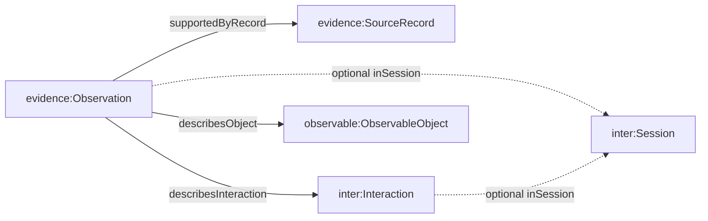

# Interactions, Observations, Records, and Objects

## Semantic roles

| Role | Representation | Meaning |
|---|---|---|
| Interaction | `inter:Interaction` | A digital action involving a honeypot, identified when the evidence permits. |
| Observation information | `evidence:Observation` | An informational account describing an interaction, an object, or available state. |
| Source record | `evidence:SourceRecord` | An identifiable record supporting that account, such as a source message or a row within a dataset version. |
| Observed digital object | UCO `observable:ObservableObject` or an appropriate subclass | An object characterized by an observation; no additional local object class is required. |

The classes and properties are defined in [interaction.ttl](../ontology/interaction.ttl) and [evidence.ttl](../ontology/evidence.ttl). These roles do not depend on a particular protocol, software product, or source schema.

An observing process is separately represented by `evidence:ObservationActivity`, aligned with UCO `observable:Observation` and PROV-O `prov:Activity`. Observation information and source records are PROV entities. Known generation and derivation relationships use PROV-O directly, as documented in [Vocabulary Reuse](./vocabulary-reuse.md).

## Description and support

`evidence:describes` is the general subject relationship. Its two specializations distinguish known interaction and object subjects:

- `evidence:describesInteraction` targets `inter:Interaction`.
- `evidence:describesObject` targets UCO `observable:ObservableObject`.
- Both are subproperties of `evidence:describes`; their relationships also count as general descriptions under RDFS entailment. Without entailment, queries must explicitly include the specialized predicates or follow their subproperty relationships.

Use the general relationship when a more specific classification is not supported, or when describing another UCO concept such as a session context or a UCO event. In particular, a producer's event label alone does not justify classifying its subject as an interaction.

`evidence:supportedByRecord` identifies supporting records. `evidence:hasSupportingArtifact` identifies retained supporting material. Neither is a description relationship, and neither implies derivation, generation, or causation.

The following is a schema diagram, not an observation dataset:

One observation may describe several subjects and use several records as support. Several observations may describe the same interaction or object. A record can summarize several interactions or accumulated state, so its presence does not require creating an interaction.

Do not equate a supporting record with the interaction it describes. Do not equate an observing activity with its informational result. The [identity policy](./identity-policy.md) governs identifiers and correspondence between representations.

## Observed objects are roles

Use UCO classes directly for digital objects, such as addresses, software, or files, when their definitions apply. The incoming description relationship establishes the object's role as an observed subject; there is no requirement to duplicate it as a local `ObservedObject` instance.

A record may itself be examined as a digital object. A captured artifact may both support an observation and be described by another observation. Consequently, informational, record, and artifact roles are not declared globally disjoint. Multiple typing must be intentional and semantically justified; it is not automatic identity reconciliation.

Property domains and ranges infer types. Applying `evidence:describesInteraction` commits the target to being an interaction; applying `evidence:describesObject` commits it to being a UCO digital object. Neither predicate should be used merely to compensate for uncertain source information.

## Optional session context

`inter:inSession` relates an interaction to a session. `evidence:inSession` relates observation information to a session. These properties have distinct domains and neither entails the other.

- Both relationships may be omitted. There are no existential, minimum-cardinality, or fixed-value restrictions requiring a session.
- An observation can have a known session without an independently identified interaction.
- An interaction can be described without knowing its session. A session can be represented without known opening or closing events.
- No property chain propagates membership between an observation, its described subjects, and its supporting records. Each asserted membership requires its own justification.
- Missing session information does not assert that no session existed. It leaves the context unspecified under the open-world interpretation.

These rules support stateless and partially recorded interactions as well as session-oriented honeypots.

## Traceability

The [traceability guide](./traceability.md) specifies paths from observations and enrichments to deployments, records, and dataset versions. Capture origin, evidential support, described subjects, lookup sources, and PROV derivation/generation remain distinct. Missing links leave partial information; they do not introduce mandatory session or provenance-process requirements.
